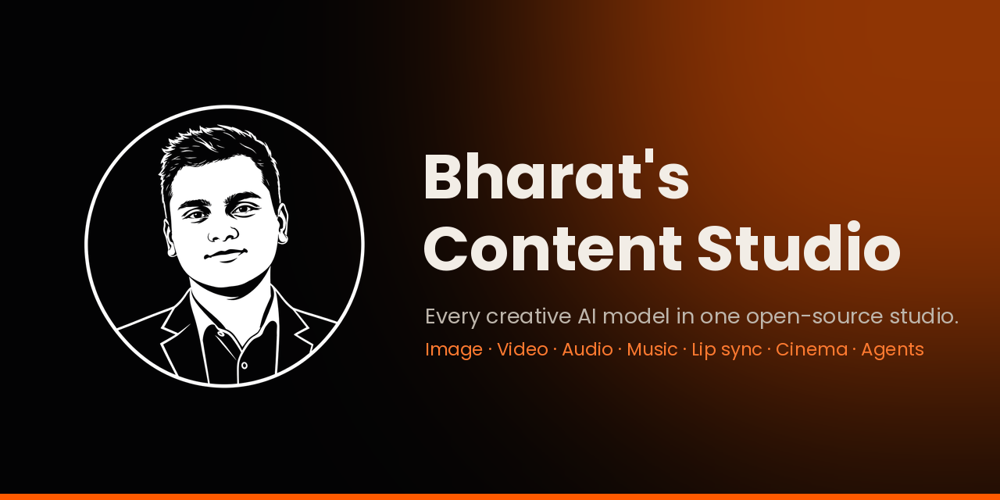
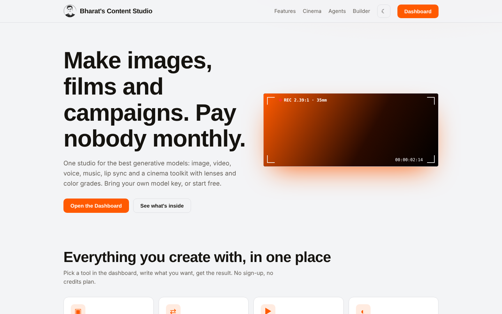
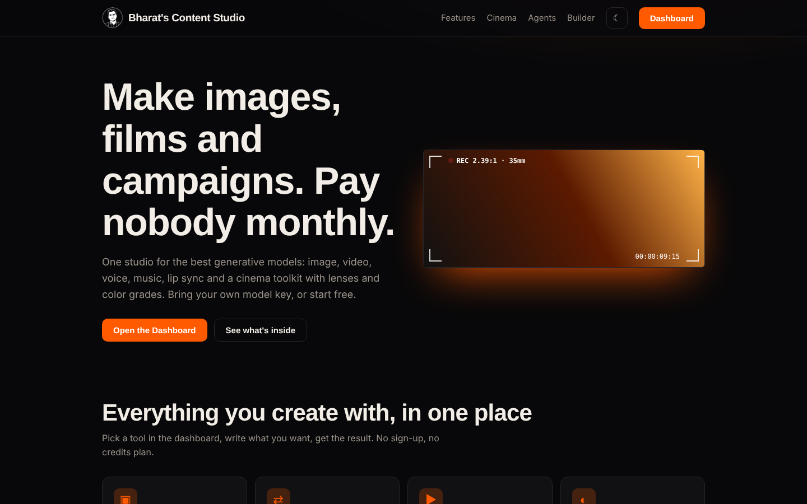
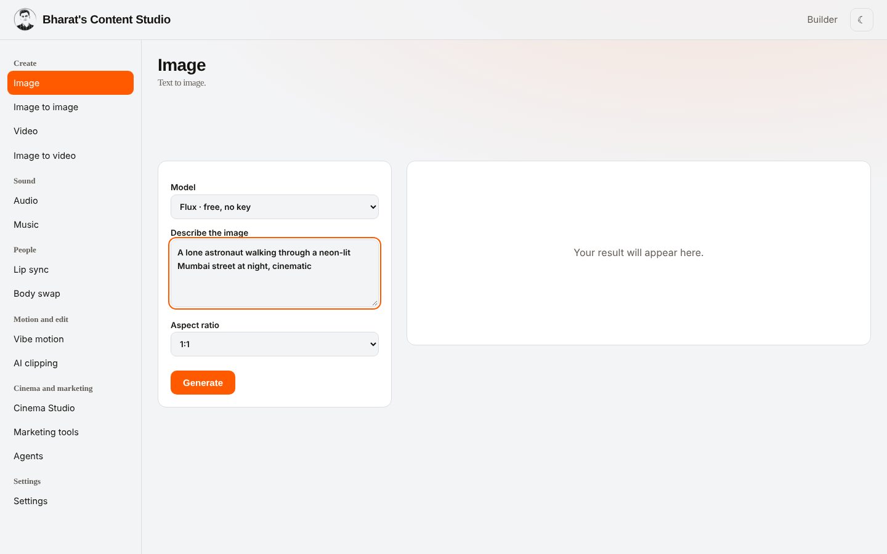
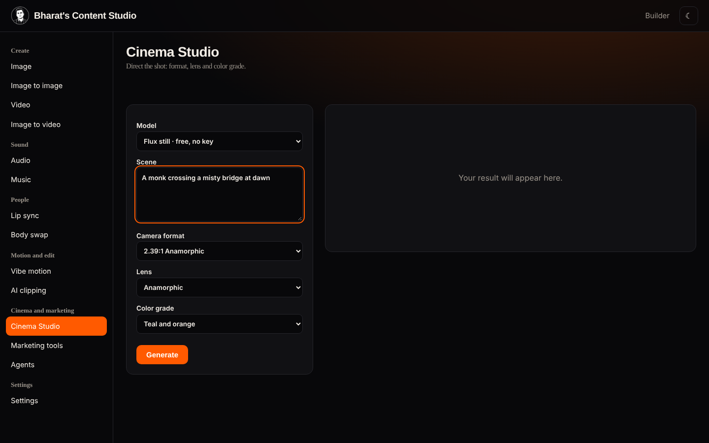
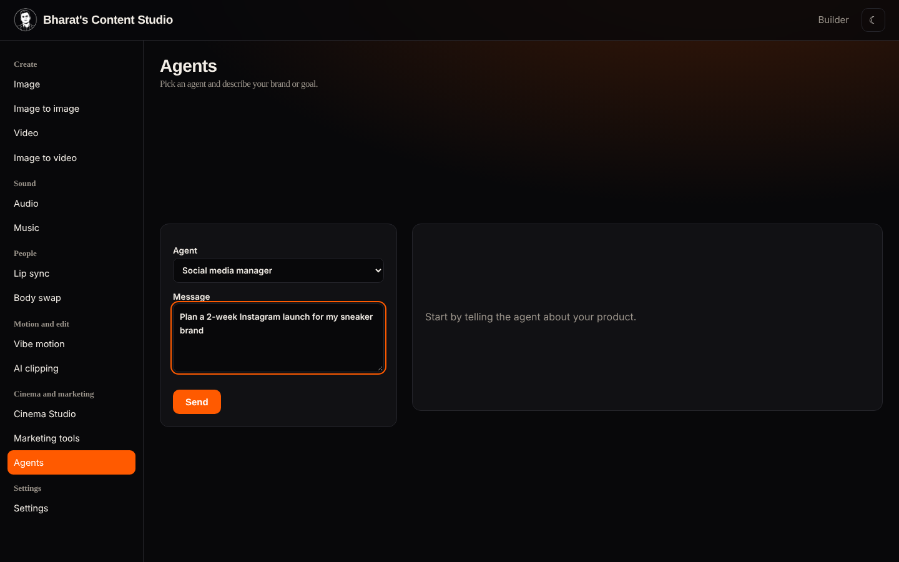

<div align="center">



# Bharat's Content Studio

**A subscription-free, open-source AI creative studio. Images, video, voice, music, lip sync, a cinema toolkit and marketing agents in one place.**

[Features](#features) · [Quick start](#quick-start) · [Deploy](#deploy-to-vercel) · [Builder](#about-the-builder)

   

</div>

---

## Demo


Full-quality video: [docs/demo.mp4](docs/demo.mp4)

## Screenshots

| Landing page (light, default) | Landing page (dark) |
|---|---|
|  |  |

| Dashboard | Image generation |
|---|---|
|  |  |

| Cinema Studio | Marketing agents |
|---|---|
|  |  |

## Why this exists

Most AI creative tools lock their best models behind monthly plans, and you end up paying for five subscriptions to make one video. Bharat's Content Studio puts the models side by side in a single interface, with no account and no plan:

- **Pay only for what you generate.** Bring your own model key; nothing recurring.
- **Start free.** Image, voice and text tools work with no key at all.
- **Private by design.** There is no server and no database. Keys and history stay in your browser.
- **One workflow.** Write the image, animate it, add the voice, cut the clip and draft the campaign without switching apps.

## Who it is for

- **Creators and editors** who want to try several models without managing several subscriptions.
- **Small businesses and freelancers** who need ad creatives, captions and campaign plans fast.
- **Students and builders** who want a clean open-source base to learn from or extend.
- **Agencies and teams** who want a self-hosted studio they control.

## Features

| Area | What you can do |
|---|---|
| Image | Text to image with Flux, Recraft and Ideogram |
| Image to image | Edit or restyle a photo with a sentence (Flux Kontext, Qwen Image Edit) |
| Video | Text to video with Kling and Veo |
| Image to video | Animate any still with Kling or Hailuo |
| Audio | Voice-overs from text, free or with ElevenLabs |
| Music | Original tracks with Stable Audio and Lyria |
| Lip sync | Make a face in a video speak your audio |
| Body swap | Put a person from one photo into another |
| Vibe motion | One-tap motion styles for stills |
| AI clipping | Finds energetic moments in a video and cuts clips, fully in the browser |
| Cinema Studio | Pick camera format, lens and color grade; it writes the prompt and renders a still or clip |
| Marketing tools | Ad copy, captions, emails, landing hero text, launch plans, scripts |
| Agents | Social media manager, campaign strategist, script writer, calendar planner, ad creative director |

The interface has a light theme by default and a dark cinematic theme, switchable from the top bar.

## How it works

1. Open the site and read what the platform offers.
2. Click **Dashboard**. There is no sign-up.
3. Choose a tool, write a prompt and press **Generate**.
4. For video, music, lip sync and premium models, paste a [fal.ai](https://fal.ai/dashboard/keys) key in **Settings** once.

| Needs no key | Needs a fal.ai key |
|---|---|
| Flux and Turbo images, studio voices, marketing tools, agents, AI clipping | Video, image to video, music, lip sync, body swap, image to image, premium image models |

## Quick start

```bash
git clone https://github.com/Bharat2456/bharats-content-studio.git
cd bharats-content-studio
npx serve .        # or: python3 -m http.server 8000
```

It is a static site, so there is nothing to build or install.

## Deploy to Vercel

1. Push this repository to GitHub.
2. In Vercel choose **Add New → Project** and import the repository.
3. Framework preset: **Other**. Leave the build command empty and click **Deploy**.
4. Share the generated URL.

## Project structure

```
index.html      Landing page
builder.html    About the builder
studio.html     Dashboard shell
studio.js       Tools, models, providers and UI logic
style.css       Light and dark themes
shell.js        Shared header, footer and theme toggle
assets/         Logo and builder photo
docs/           Banner, screenshots and demo video
scripts/        capture.mjs, regenerates screenshots and the demo
```

## Customize

- **Models:** edit the `T` array in `studio.js`. Each tool lists its model IDs and input mapping.
- **Theme:** colors are CSS variables at the top of `style.css`.
- **Regenerate screenshots and demo:** `npm i --no-save playwright && npx playwright install chromium && node scripts/capture.mjs`

## Privacy

Everything runs in your browser. Your fal.ai key is stored in local storage and sent only to fal.ai. Free image, voice and text requests go to Pollinations. This project collects no analytics and has no backend.

## About the builder

Built by **Bharat Wagh**, a 21-year-old Computer Engineering student at TSSM's Padmabhooshan Vasantdada Patil Institute of Technology, Pune. Open to freelance work.

[LinkedIn](https://www.linkedin.com/in/bharat-wagh-96b3082a8) · [GitHub](https://github.com/Bharat2456) · [Instagram](https://instagram.com/doppelganger.bharat) · [X](https://x.com/BharatWagh1010)

## Contributing

Issues and pull requests are welcome. Fixes for model IDs and new providers are especially useful.

## License

MIT. See [LICENSE](LICENSE).
